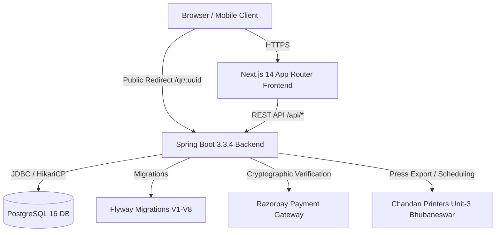

# PRACHAR System Architecture Specification

## 1. System Vision & Domain Architecture
PRACHAR is a hybrid phygital platform designed to empower local businesses, professionals, and merchants across Odisha (starting in Bhubaneswar) by synchronizing permanent physical print media with dynamic digital identity and cloud profiles.

The architecture bridges two core media channels:
1. **Physical Channel**: 50,000+ monthly print booklet directories printed at Chandan Printers (Unit-3, Bhubaneswar) featuring standard rate matrix placements (P1 Full Page Cover through P5 Business Card Showcase), each embedded with a permanent dynamic QR code.
2. **Digital Channel**: High-performance mobile-first merchant micro-sites (`/u/[username]`), companion NFC-ready digital business cards, and dynamic redirection infrastructure (`/qr/[uuid]`).

---

## 2. Tiered Component Architecture

### 2.1 Frontend Architecture (Next.js 14 App Router)
- **Framework**: Next.js 14.2.14, React 18, TypeScript 5.
- **Styling**: Vanilla Tailwind CSS with custom editorial brand tokens (`#0A0A0C`, `#121216`, `#FFB703`, luxury serif accents).
- **Routing & Presentation**:
  - `app/`: Pure route definitions and layout compositions.
  - `components/ui/`: Generic UI primitives (`Modal`, `StatusBadge`, `Spinner`, `Skeleton`).
  - `components/feedback/`: User feedback states (`EmptyState`, `ErrorState`).
  - `features/`: Domain-isolated modules:
    - `features/advertising/`: `PackageSelectionCard`, `EditionCutoffBanner`, `AdSummaryMetrics`.
    - `features/payment/`: `PaymentCheckoutModal` encapsulating Razorpay checkout and fallback simulation.
    - `features/profile/`: `DigitalCardPreview`, `ProfileEditorForm`.
    - `features/admin/`: `AdminAdQueueTable`, `AdminReviewModal`.
  - `lib/api/`: Domain-specific API clients (`auth.ts`, `profile.ts`, `card.ts`, `advertising.ts`, `payment.ts`, `admin.ts`) orchestrated via `client.ts`.
  - `lib/config/`: Validated runtime environment via `env.ts`.
  - `lib/constants/`: Centralized themes, categories, and Odisha geography tokens.

### 2.2 Backend Architecture (Java 21 / Spring Boot 3.3.4)
- **Runtime**: Java 21 LTS with Spring Boot 3.3.4.
- **Layering**:
  - **Controllers**: Thin HTTP boundary handlers validating `@Valid` request bodies and returning `ApiResponse<T>`.
  - **Services**: Transactional business workflow orchestrators (`@Transactional`).
  - **Domain Repositories**: Spring Data JPA repositories with query isolation.
  - **Security Filter Chain**: Stateless JWT authentication filter, role-based authorization rules, and Jackson-serialized error entry points.
  - **Production Security Validator**: Fail-fast startup checks enforcing entropy requirements on secrets in non-dev profiles.
  - **Common Exception Hierarchy**: Centralized `@RestControllerAdvice` mapping domain exceptions (`ResourceNotFoundException`, `SecurityViolationException`, etc.) to structured, correlation-tagged error envelopes.

---

## 3. Core Subsystems

### 3.1 Digital Identity & Companion Cards
- Every registered user is provisioned a Merchant Profile and a Companion Digital Card (`com.prachar.card`).
- The digital card includes customizable brand accent colors (`#0F172A`, `#7C2D12`, `#1E3A8A`, `#14532D`, `#581C87`, `#831843`), vanity URL bindings (`/u/[slug]`), and NFC toggle capability.
- Controllers delegate all operations to `DigitalCardService` and return strict `DigitalCardResponseDto` instances.

### 3.2 Phygital Dynamic QR Engine
- Permanent UUID tokens (`com.prachar.qr`) decoupled from changing destination URLs.
- When scanned, `/qr/{uuid}` routes to `QRRedirectController`, which:
  1. Validates that the QR code is `ACTIVE`.
  2. Validates that the underlying Merchant Profile is `ACTIVE`.
  3. Checks destination URL against malicious protocol/domain injection (`SecurityViolationException`).
  4. Records DPDP Act 2023 compliant telemetry (SHA-256 hashed IP address, user agent, timestamp).
  5. Performs an HTTP 302 redirect to the merchant profile.

### 3.3 Print Advertising & Rate Matrix
- Authoritative print directory packages (`P1` through `P5`):
  - **P1**: Full Page Premium Cover (180 mm × 250 mm)
  - **P2**: Full Page Standard (180 mm × 250 mm)
  - **P3**: Half Page Display (180 mm × 120 mm)
  - **P4**: Quarter Page Grid (88 mm × 120 mm)
  - **P5**: Business Card Showcase (88 mm × 55 mm)
- **Cutoff Engine**: Monthly print edition deadline strictly enforced at 18:00 IST on the 18th of every month. Submissions after cutoff automatically roll over to the subsequent edition.
- **Multi-Edition Scheme**: 3-edition series bookings automatically receive built-in volume discount savings calculated deterministically.

### 3.4 Payment Engine & Idempotency Ledger
- Financial integration with Razorpay (`com.prachar.payment`).
- Generates server-side payment orders and verifies Razorpay cryptographic HMAC-SHA256 signatures (`razorpay_order_id|razorpay_payment_id` against `key_secret`).
- Idempotent transaction ledger prevents double-confirmation of duplicate callbacks or webhook replays.

---

## 4. Database Persistence & Flyway Migrations
PostgreSQL 16 database managed exclusively via forward-only Flyway migrations:
- `V1__init_schema.sql`: Base tables (users, roles, permissions).
- `V2__add_profiles.sql`: Merchant profiles, categories, addresses.
- `V3__add_digital_cards.sql`: Digital card customization and NFC states.
- `V4__add_dynamic_qr.sql`: Dynamic QR codes, targets, and scan tracking.
- `V5__add_qr_analytics.sql`: Telemetry tables with hashed DPDP identifiers.
- `V6__add_advertising.sql`: Print rate cards, bookings, and cutoff schedules.
- `V7__add_payments.sql`: Payment transactions and Razorpay references.
- `V8__add_admin_audit.sql`: Editorial review audit trails and notes.

Historical migrations remain strictly immutable. Schema evolution occurs exclusively via forward-only numbered migration scripts.
